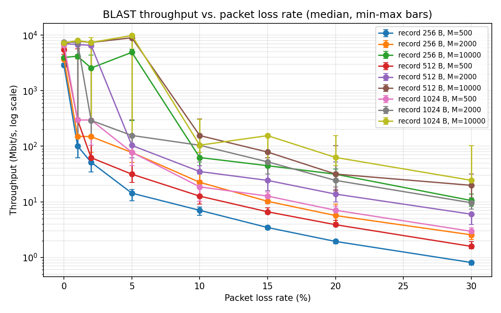
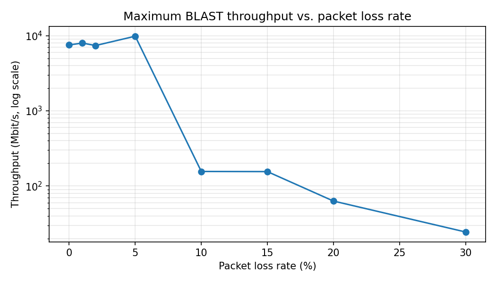

# BLAST: Fast File Transfer over UDP

**CSc 412 Computer Networks — Programming Project**  
Instructor: Prof. K. Ravindran  
Student: Md Mamun (individual project)  
Date: October 2026

## 1. Introduction

This project implements BLAST, a file-transfer protocol that sends a large file over UDP "in full
blast": it sends many records back-to-back and asks for acknowledgment only once per blast, instead
of acknowledging every packet as TCP does. Lost records are found by a single query at the end of
each blast and resent selectively.

The implementation is in C using the UNIX socket interface to UDP. It consists of a file sender, a
file receiver, and a garbler that drops packets at a set rate. I measured throughput for loss rates
from 0% to 30%, for all three record sizes and three blast sizes, with 5 runs per setting
(360 transfers in total). Every received file was checked against the original; all 360 transfers
were correct.

The project was approved by the instructor to run on macOS instead of Linux. The code uses only
POSIX sockets and threads and also builds on Linux.

## 2. System overview

| File | Contents |
|---|---|
| `blast.h` | Packet formats shared by sender and receiver |
| `garble.h` | Garbler: drops each outgoing packet with a given probability |
| `sender.c` | File sender: protocol state machine, disk-reader thread, buffer B' |
| `receiver.c` | File receiver: protocol state machine, buffer B', disk-writer thread |
| `Makefile` | Builds `sender` and `receiver` |
| `run_experiments.sh` | Runs transfers over loss rates × record sizes × M, writes `results.csv` |
| `plot.py` | Produces the graphs and summary tables from `results.csv` |

Build with `make`, then run:

```
./receiver <port> <max_M> [loss_rate]
./sender <receiver_ip> <port> <file> <record_size> <M> [loss_rate] [dest_name]
```

`record_size` is 256, 512 or 1024 bytes; `M` (records per blast) is 200–10000; `loss_rate` is a
probability such as `0.1`; `dest_name` is the name the receiver stores the file under (default: the
file's own name). The receiver serves one transfer after another until it is stopped.

Following Figure 1 of the assignment, each side has its own buffer B' between the disk and the UDP
socket. On each side a separate thread moves data between the disk and B', so disk I/O and network
I/O proceed asynchronously (Section 5).

## 3. Packet formats

All multi-byte fields are sent in network byte order.

| Packet | Fields |
|---|---|
| FILE_HDR | type, file size, record size, M (proposed), name to store the file under |
| FILE_HDR_ACK | type, status (0 = accepted), record size, M (agreed) |
| DATA | type, N, N × (st_rec, end_rec), then the records of segments 1..N in order |
| IS_BLAST_OVER | type, seq, Mst, Mfin |
| REC_MISS | type, seq, Mst, Mfin, count, count × (st_rec, end_rec) — an empty list means the blast is complete |
| DISCONNECT | type |
| DISCONNECT_ACK | type |

Records are numbered from 1. A DATA packet carries at most 16 records in at most 16 segments. On
macOS a UDP datagram is limited to 9216 bytes by default, so 256- and 512-byte records travel up to
16 per packet and 1024-byte records up to 8 per packet. On Linux, 1024-byte records also travel 16
per packet.

**M negotiation.** The sender proposes M in FILE_HDR. The receiver accepts it or lowers it to its
own buffer limit (`max_M`) and returns the agreed value in FILE_HDR_ACK. Both sides then use the
agreed M and record size for the whole transfer.

## 4. Protocol state machines

### 4.1 Sender

| State | Action | Event → next state |
|---|---|---|
| CONNECT | send FILE_HDR | FILE_HDR_ACK (accepted) → BLAST; timeout 1 s → resend (max 20 tries, then abort) |
| BLAST | send the records of the current blast as they become available from disk | all records sent → QUERY |
| QUERY | send IS_BLAST_OVER(Mst, Mfin) with a new seq | REC_MISS with ranges → RESEND; REC_MISS empty → next blast's BLAST, or DISCONNECT after the last blast; timeout 300 ms → resend IS_BLAST_OVER (max 30 tries, then abort) |
| RESEND | send the listed records, packed into multi-segment packets | all sent → QUERY |
| DISCONNECT | send DISCONNECT | DISCONNECT_ACK → DONE; timeout 300 ms → resend (max 10 tries, then DONE, since all data is already confirmed) |

### 4.2 Receiver

| State | Event | Action |
|---|---|---|
| IDLE | FILE_HDR | open `<name>.part`, agree on record size and M, start the writer thread, reply FILE_HDR_ACK → ACTIVE |
| ACTIVE | FILE_HDR (duplicate) | reply FILE_HDR_ACK again (the first ACK was lost) |
| ACTIVE | DATA | store new records in B', mark them received, hand the contiguous prefix to the writer |
| ACTIVE | IS_BLAST_OVER | reply REC_MISS listing missing ranges in Mst..Mfin, echoing seq |
| ACTIVE | DISCONNECT | flush B' to disk, close, rename `<name>.part` to `<name>`, reply DISCONNECT_ACK → LINGER |
| LINGER (3 s) | IS_BLAST_OVER / DISCONNECT | reply REC_MISS / DISCONNECT_ACK again (sender's reply was lost) |
| LINGER | 3 s elapsed, or a new FILE_HDR | release the transfer → IDLE |

### 4.3 Timeouts

Timeouts use `SO_RCVTIMEO` on the socket: `recvfrom` returns `EAGAIN` when no packet arrives within
the timeout, and the sender retransmits. This behaves like `alarm()` with a SIGALRM handler, without
the races of interrupting a system call from a signal handler.

### 4.4 Sequence number in IS_BLAST_OVER

I added a sequence number to IS_BLAST_OVER, which the receiver echoes in REC_MISS. Without it, a late
REC_MISS answering an earlier query of the same blast could be mistaken for the answer to the current
query, causing records to be sent again needlessly. The sender ignores any REC_MISS whose seq is not
the current one.

### 4.5 Example

The trace below is from the timing scenario of Figure 2 in the assignment and matches what the
implementation does (records 5–6, 8–10 and 21–38 lost in the first pass):

```
sender                                              receiver
{(1,4)} r1..r4 ------------------------------------> stored
{(5,6)} r5,r6  ---------------X lost
 ...
IS_BLAST_OVER(1,38) -------------------------------->
<---------------------------- REC_MISS({(5,6),(8,10),(21,38)})
{(5,6),(8,10),(21,31)} r5,r6,r8..r10,r21..r31 ----->  (3 segments in one packet)
{(32,38)} r32..r38 ------------X lost
IS_BLAST_OVER(1,38) -------------------------------->
<---------------------------------------- REC_MISS({(32,38)})
{(32,38)} r32..r38 -------------------------------->
IS_BLAST_OVER(1,38) -------------------------------->
<------------------------------------------------- REC_MISS({})
```

## 5. Buffers and asynchronous disk I/O

The assignment asks that reading from disk, network transfer, and writing to disk may proceed
asynchronously, which is why a packet can carry a variable number of records.

**Sender.** B' is a ring of M record slots; record *r* lives in slot (*r*−1) mod M. A reader thread
reads the file into B' in chunks of a random size between 1 and 40 records, independently of the
network, and publishes how many records are available. The sending loop sends whatever records are
available at that moment: if only 3 records are ready, it sends a packet with 3 records rather than
waiting for 16. This reproduces the "records 5–6 available", "record 7 available" behaviour of
Figure 2. The reader may refill a slot only after the blast that used it has been confirmed by an
empty REC_MISS, because retransmissions still need the data.

**Receiver.** B' is also a ring of M record slots. The network side copies each new record into B'
and keeps track of the longest prefix of the file that has fully arrived. A writer thread writes that
prefix from B' to disk, independently of the network. The network side may reuse a slot only after
the writer has written the record that was in it. On DISCONNECT the receiver waits for the writer to
flush the rest, then closes the file and renames it from `<name>.part` to `<name>`, so a file under
the final name is always complete.

The measurements show the variable packet sizes: with 256-byte records and M = 500, about 7% of the
data packets carried fewer than 16 records (214 of 3037 on average at 0% loss), and the average was
15.4 records per packet.

## 6. Garbler

The garbler (`garble.h`) wraps `sendto`. Each outgoing packet is dropped with probability *p*, using
an independent random draw. Both the sender and the receiver send through the garbler, so data
packets and every control packet (FILE_HDR, FILE_HDR_ACK, IS_BLAST_OVER, REC_MISS, DISCONNECT,
DISCONNECT_ACK) can be lost. Each program counts the packets it attempted to send and the packets the
garbler dropped.

Table 1 shows that the measured drop rate matches the configured rate closely.

## 7. Experiment method

- **Machine:** Apple MacBook Pro 14-inch (2023, M2 Pro, 16 GB RAM), macOS 26.6.2.
- **Network:** sender and receiver on the same machine, communicating over the loopback interface
  (127.0.0.1).
- **File:** 12,000,021 bytes of random data (96.0 Mbit). The size is deliberately not a multiple of
  the record size, so the short final record is exercised.
- **Settings:** loss rate *p* ∈ {0, 1, 2, 5, 10, 15, 20, 30}%, record size ∈ {256, 512, 1024} bytes,
  M ∈ {500, 2000, 10000} records, 5 runs each: 8 × 3 × 3 × 5 = 360 transfers.
- **Correctness check:** after every transfer the received file was compared with the original by
  checksum (`cksum`). All 360 transfers were correct.
- **Throughput** = file size ÷ time from the start of the first blast to the empty REC_MISS for the
  last blast. Connection setup and disconnect are excluded.

Command used:

```
make
./run_experiments.sh test12mb.bin "256 512 1024" "500 2000 10000" 5
python3 plot.py
```

**A note on the test setup.** In the first full run, 4 of the 360 transfers were reported as failed.
Investigation showed the received data was complete and byte-for-byte correct in every case: the
project folder is synced by iCloud Drive, which occasionally renamed the receiver's output file while
it was being written (e.g. to `recv_test12mb 2.bin.part`), so the receiver's final rename failed. The
experiment script now runs the receiver in a temporary directory outside the synced folder, and the
4 affected transfers were rerun under the same settings; all passed.

## 8. Results

### 8.1 Packet loss statistics

Table 1 is averaged over all 45 transfers (9 settings × 5 runs) at each loss rate. "Sender" counts
packets sent by the sender (data, FILE_HDR, IS_BLAST_OVER, DISCONNECT); "receiver" counts packets
sent by the receiver (ACKs and REC_MISS).

**Table 1. Packets sent and lost per transfer (average)**

| Loss rate | Data packets sent | Sender: dropped / sent | Receiver: dropped / sent | Measured drop rate | Records resent | Timeouts |
|---:|---:|---:|---:|---:|---:|---:|
| 0% | 1984 | 0 / 2010 | 0.0 / 25.1 | 0.00% | 0 | 0.0 |
| 1% | 2004 | 20 / 2041 | 0.5 / 35.7 | 1.01% | 275 | 0.8 |
| 2% | 2024 | 40 / 2067 | 0.7 / 40.8 | 1.92% | 529 | 1.8 |
| 5% | 2092 | 106 / 2148 | 2.8 / 52.4 | 4.94% | 1423 | 5.4 |
| 10% | 2210 | 229 / 2287 | 6.4 / 67.4 | 10.02% | 3032 | 14.0 |
| 15% | 2338 | 363 / 2437 | 12.2 / 83.2 | 14.89% | 4788 | 26.0 |
| 20% | 2480 | 515 / 2609 | 21.0 / 101.6 | 19.76% | 6717 | 46.0 |
| 30% | 2843 | 919 / 3060 | 44.4 / 148.6 | 30.03% | 11683 | 110.4 |

Over all 360 transfers, the garbler dropped 102,623 of 864,598 packets.

### 8.2 Throughput versus loss rate



**Figure 1.** Median throughput of 5 runs for each record size and M; bars show the minimum and
maximum. The y-axis is logarithmic.



**Figure 2.** Maximum achievable throughput: the best setting at each loss rate (settings listed in
Table 2).

**Table 2. Maximum throughput (best median over all settings)**

| Loss rate | Max throughput (Mbit/s) | Best setting |
|---:|---:|---|
| 0% | 7523 | 1024 B, M = 2000 |
| 1% | 7966 | 1024 B, M = 10000 |
| 2% | 7387 | 1024 B, M = 10000 |
| 5% | 9830 | 1024 B, M = 10000 |
| 10% | 156 | 512 B, M = 10000 |
| 15% | 155 | 1024 B, M = 10000 |
| 20% | 63 | 1024 B, M = 10000 |
| 30% | 24 | 1024 B, M = 10000 |

**Table 3. Median throughput (Mbit/s) for every setting**

| Loss | 256/500 | 256/2000 | 256/10000 | 512/500 | 512/2000 | 512/10000 | 1024/500 | 1024/2000 | 1024/10000 |
|---:|---:|---:|---:|---:|---:|---:|---:|---:|---:|
| 0% | 2892 | 3689 | 3957 | 5485 | 6989 | 7132 | 6645 | 7523 | 7236 |
| 1% | 101 | 151 | 4180 | 298 | 6782 | 7800 | 297 | 7403 | 7966 |
| 2% | 51.5 | 149 | 2558 | 62.2 | 6533 | 7381 | 297 | 292 | 7388 |
| 5% | 14.3 | 77.3 | 4900 | 31.4 | 104 | 8957 | 77.9 | 156 | 9830 |
| 10% | 7.0 | 22.5 | 62.6 | 12.7 | 35.1 | 156 | 18.6 | 104 | 105 |
| 15% | 3.5 | 10.2 | 44.7 | 6.6 | 24.3 | 78.7 | 12.7 | 52.4 | 155 |
| 20% | 1.9 | 5.7 | 31.4 | 3.9 | 13.8 | 31.6 | 7.1 | 24.3 | 63.0 |
| 30% | 0.8 | 2.5 | 10.6 | 1.6 | 6.0 | 19.8 | 3.0 | 9.6 | 24.4 |

(Column headings are record size in bytes / M.)

**Table 4. Detail for the best setting (1024 B, M = 10000) and the smallest (256 B, M = 500)**

| Loss | 1024/10000 median time (s) | timeouts | records resent | 256/500 median time (s) | timeouts | records resent |
|---:|---:|---:|---:|---:|---:|---:|
| 0% | 0.013 | 0.0 | 0 | 0.033 | 0.0 | 0 |
| 1% | 0.012 | 0.0 | 109 | 0.950 | 3.2 | 403 |
| 2% | 0.013 | 0.4 | 259 | 1.864 | 5.8 | 847 |
| 5% | 0.010 | 0.4 | 604 | 6.702 | 22.6 | 2359 |
| 10% | 0.917 | 2.6 | 1385 | 13.643 | 45.4 | 5211 |
| 15% | 0.618 | 3.4 | 2101 | 27.809 | 92.8 | 8391 |
| 20% | 1.524 | 4.8 | 2891 | 49.514 | 165.8 | 11637 |
| 30% | 3.933 | 12.0 | 5066 | 118.473 | 397.0 | 19810 |

## 9. Discussion

**Timeouts, not resent data, determine throughput.** Without loss, the whole 12 MB file is sent in
10–35 ms (up to about 7.5 Gbit/s over loopback). Resending lost records costs very little: at 30%
loss the best setting resends 5066 records, which takes only milliseconds. What costs time is losing
a control packet. When an IS_BLAST_OVER or its REC_MISS is lost, the sender waits the full 300 ms
timeout before asking again — more than 20 times the duration of an entire loss-free transfer.
Transfer time is therefore approximately

  *time ≈ (time to send the data) + 0.3 s × (number of timeouts)*.

For 256 B / M = 500 at 30% loss, 397 timeouts × 0.3 s = 119 s, against a measured median of 118.5 s.

**Throughput is bimodal.** One timeout limits throughput to at most 96 Mbit ÷ 0.3 s ≈ 320 Mbit/s;
two timeouts to about 160 Mbit/s; three to about 107 Mbit/s. The measured values cluster at exactly
these levels (≈ 300, 150, 100 Mbit/s in Table 3), and a run with no timeout jumps back to several
Gbit/s. This is why the min–max bars in Figure 1 are so wide at 1–5% loss, and why the report uses
the median rather than the mean. The differences among runs with no timeout (e.g. 9830 Mbit/s at 5%
versus 7523 Mbit/s at 0%) are measurement noise: a 10 ms transfer is sensitive to CPU scheduling, so
those values should not be read as loss making the transfer faster.

**How many timeouts to expect.** One query round succeeds only if IS_BLAST_OVER and REC_MISS both
get through, with probability (1 − *p*)². At 30% loss that is 0.49, so each round costs about one
timeout on average. Each blast needs several rounds, since every round some resent records are lost
again; for a blast of *n* packets, roughly 1 + log(*n*) / log(1/*p*) rounds. For 256 B / M = 500
(94 blasts of about 32 packets), this predicts about 3.9 rounds and 4.0 timeouts per blast; the
measurement is 4.2 timeouts per blast.

**Effect of M.** A larger M means fewer blasts, so fewer IS_BLAST_OVER rounds and fewer chances to
lose a control packet. M = 10000 was the best or nearly the best choice at every loss rate above 0%:
at 30% loss, 1024 B records reach 24.4 Mbit/s with M = 10000 versus 3.0 Mbit/s with M = 500, an
8-fold difference. The cost of a large M is buffer memory: M × record size on each side (10 MB for
M = 10000 and 1024-byte records).

**Effect of record size.** Larger records mean fewer packets for the same file, so fewer per-packet
system calls and, under loss, fewer packets to lose and resend. Without loss, 1024 B and 512 B
records reach 7–7.5 Gbit/s versus about 3.9 Gbit/s for 256 B records. Under loss, larger records
also mean fewer packets per blast and therefore fewer rounds per blast.

**Possible improvements.** The results point to the timeout as the main cost. Useful changes would
be an adaptive timeout based on the measured round-trip time (on loopback the RTT is well under
1 ms, so 300 ms is far too conservative), or sending IS_BLAST_OVER twice, since losing one copy
alone would then no longer cause a timeout.

**Limitations.** Sender and receiver ran on one machine over loopback, so the absolute numbers
reflect memory and CPU speed rather than a physical network; on Ethernet the loss-free rate would be
bounded by the link speed (e.g. 1 Gbit/s). The relative behaviour — the cost of timeouts, and the
benefit of larger M and records — does not depend on the link. On macOS, 1024-byte records travel 8
per packet instead of 16 because of the datagram size limit.

## 10. Conclusion

The implementation delivers all three phases of BLAST: connection setup with negotiation of the
record size and M, blasts with selective retransmission through IS_BLAST_OVER and REC_MISS with
multi-segment packets, and a disconnect with a linger period. Disk reading and writing run in
separate threads from the network, so packets carry a variable number of records as the assignment
requires. All 360 measured transfers were delivered correctly at loss rates up to 30%. Maximum
throughput falls from about 7.5 Gbit/s without loss to 156 Mbit/s at 10% and 24 Mbit/s at 30%, and
is governed by the number of 300 ms timeouts caused by lost control packets. The largest blast size
(M = 10000) and the largest record size (1024 B) gave the highest throughput under loss.

## 11. Project role

This was an individual project. Md Mamun did all parts: protocol and packet design, the sender and
receiver state machines, buffering and threads, the garbler, the experiments, and this report.

## Appendix: source code

The source files `blast.h`, `garble.h`, `sender.c`, `receiver.c`, `run_experiments.sh`, and
`plot.py` follow.
